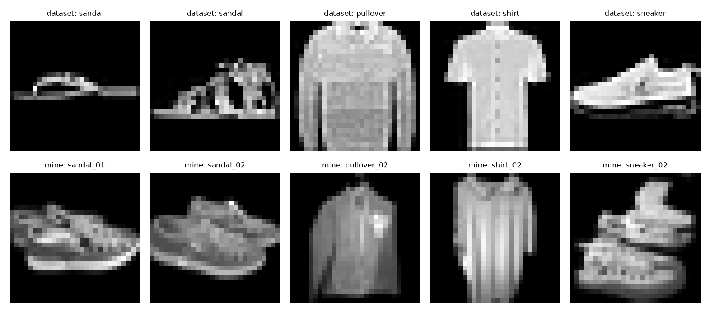

# Fashion MNIST Shirt Classifier: what happens when a 90% model meets real photos

Built by **Adeyemi Ibrahim Boluwatife** (PerceptronCipher), AI/ML engineer.

I trained a CNN that scores about 90% on the Fashion MNIST benchmark, then tested it on photos of my own clothes. It got 18% of them right.

## What I measured

| Test set | Plain preprocessing | With background removal |
|---|---|---|
| Fashion MNIST test set (10,000 images) | 90.4% | n/a |
| My casual phone photos (22) | 18.2% (4/22) | 36.4% (8/22) |
| My flat, dataset-style photos (7) | 28.6% (2/7) | 42.9% (3/7) |



## What I found

- **Without background removal, the model collapsed onto two answers.** 21 of my 22 photos came back as "Bag" or "Shirt". Real backgrounds fill the 28x28 frame with a bright blob, which is closest to those two classes. The "Shirt 3/4" I first saw was the model defaulting, not skill.
- **Cutting the item out and placing it on black doubled accuracy** (18% to 36%) by making a photo look more like the training data.
- **Pose isn't the main explanation.** Flat, dataset-style photos scored 43%, against 36% for casual ones. With 7 photos that's one image of difference, so I can't claim more.
- **Boosting contrast did nothing.** Same predictions before and after.

## Limits of this test

- 22 casual photos and 7 flat photos, several of the same items. One photo moves the score by 4.5 to 14 points.
- I chose the preprocessing after seeing the failures on these same photos, so the "with background removal" scores are optimistic.
- Some labels are debatable: two of my "sandals" are closed shoes, which the dataset's sandal class doesn't cover.
- One coat photo's cutout failed, so that test is invalid.

## What's in the repo

- `model/`: CNN training, evaluation scripts, and the background-removal preprocessing
- `backend/`: FastAPI service with `POST /predict` (top-3 classes), using the same background-removal preprocessing as the tests above
- `frontend/`: Next.js camera app

## Run it

```bash
cd backend
python3 -m venv .venv && source .venv/bin/activate
pip install -r requirements.txt
python -m uvicorn main:app --reload

cd ../frontend
echo "NEXT_PUBLIC_API_URL=http://127.0.0.1:8000" > .env.local
npm install && npm run dev
```

Open `http://localhost:3000` (the camera only works on localhost or HTTPS). To reproduce the photo tests, run `pip install "rembg[cpu]"`, put labelled photos in `model/my_photos/` named like `shirt_01.jpg`, and run `python evaluate_compare.py my_photos` from `model/`.

## Next

Add photo upload, retrain with augmentation on varied backgrounds, and deploy publicly.

## Author

Adeyemi Ibrahim Boluwatife
[GitHub](https://github.com/PerceptronCipher) | [LinkedIn](https://www.linkedin.com/in/adeyemi-ibrahim-boluwatife-74329a383)

MIT License